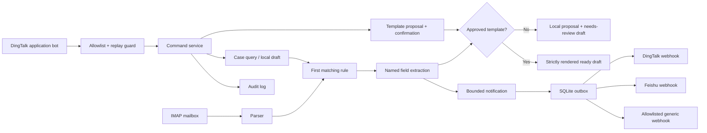

# Architecture

[English](architecture.md) | [简体中文](architecture.zh-CN.md)

The project deliberately separates untrusted email content, local state, template approval,
and outbound delivery.

## Inbound state

Each mailbox has a checkpoint composed of account ID, folder, `UIDVALIDITY`, and last UID.
The default first run records the highest current UID without processing history. A changed
`UIDVALIDITY` is treated as a new mailbox generation and safely baselined again.

Message deduplication prefers the RFC `Message-ID`, scoped by configured account ID. When a
message has no `Message-ID`, the key falls back to `UIDVALIDITY` plus UID. A message is recorded
and its outbound jobs are inserted in one SQLite transaction.
Deduplication runs before draft generation. Draft paths include a content hash so a preview or
duplicate with different contents cannot replace the file referenced by an existing case.

MIME parse failures and messages reaching the fetch size cap are persisted as metadata-only
quarantine rows before advancing the checkpoint. They do not block later UIDs. Transport failures
do not advance the checkpoint and are retried on the next scan; no source email is deleted.

## Template trust boundary

Incoming email never modifies an approved template. It can only trigger creation of a local
proposal that contains configured match patterns, configured field extractors, and a local
starter response. A human may edit that file and must run an explicit approval command.

Rendering uses a fixed placeholder map. Attribute/index expressions, format widths and conversions are rejected. Required
fields and all referenced placeholders must be present; otherwise no reply draft is produced.
Rendering is size-checked before string expansion. A needs-review case can be refreshed using its
saved extraction values only if the approved template has the same match/extraction fingerprint.
Already-ready drafts are historical snapshots and are not silently rewritten on template updates.

Template writers share a bounded OS file lock. Confirmation records an `applying` intent before
atomic file replacement, then records the revision and completion. Retrying the same change ID
finishes an interrupted update; another proposal cannot overwrite that unfinished change. This
is recovery across a file/database boundary, not a single transaction spanning both stores.

## Delivery boundary

The database stores the notifier ID and sanitized message payload, not the webhook URL or
signing secret. The adapter resolves secrets only at delivery time. Failed jobs use bounded
exponential backoff and eventually move to `dead_letter`.

Webhook redirects are disabled. DingTalk and Feishu use built-in official host allowlists;
generic webhook hosts must be listed by the operator.
DingTalk/Feishu require an explicit provider success code; generic endpoints may return an empty
successful response. Ignoring a case cancels pending jobs, but cannot recall a job already in flight.

## Deliberate exclusions

The generic profile has no inbound chat process. Version 0.2 adds an optional personal interaction
process with an allowlisted DingTalk Stream connector. It shares only the local case/template store;
it does not broaden IMAP or webhook permissions. Inbound event IDs are idempotent, stale events are
rejected, mutations require an admin allowlist, and user/chat IDs are pseudonymized in audit rows.
Cached responses are bound to the bot, chat, user and request fingerprint and are only read after
current authorization. Interrupted reservations become retryable after a lease. This protects
event replay; it does not provide per-mailbox access control inside an instance.

Use one mail poller/outbox sender and an optional companion bot on the same local filesystem.
All allowlisted users share the instance's cases and templates; isolate different audiences with
independent deployments. At-least-once retries can repeat a remote response or notification.

There is still no SMTP sending, OAuth, saved attachment or attachment-URL fetch, URL fetch from
message bodies, or remote AI call. Raw MIME reads are size-capped. A Feishu application-bot inbound
adapter remains a separate future boundary; Feishu custom Webhooks continue to be outbound-only.
