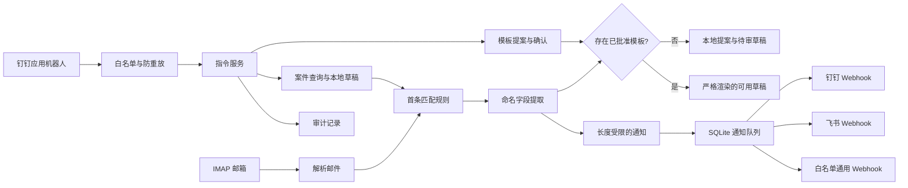

# 架构说明

[English](architecture.md) | **简体中文**

项目将不可信邮件、本地状态、模板审批和对外通知分开处理。

## 收信状态

每个邮箱的断点由账号 ID、文件夹、`UIDVALIDITY` 和最后处理的 UID 组成。首次运行默认只记录当前最大 UID，不处理历史邮件。
`UIDVALIDITY` 改变时，将其视为新一代邮箱状态，重新建立基线。

去重优先使用 RFC `Message-ID`，并按配置的账号 ID 隔离。缺少 `Message-ID` 时，使用 `UIDVALIDITY` 与 UID。
邮件记录及其待发任务在同一个 SQLite 事务中插入。去重先于草稿生成；草稿路径包含内容摘要，避免不同内容的预览或重复邮件覆盖既有案件引用的文件。

无法解析的 MIME 或达到读取大小上限的邮件，会先保存仅含元数据的隔离记录，再推进断点，不阻塞后续 UID。
传输失败则不推进断点，下一轮重新尝试；不会删除原邮件。

## 模板信任边界

收到邮件不会修改已批准模板，只能触发本地提案，提案包含配置的匹配条件、字段提取规则及起始回复文本。
人工编辑后，必须执行明确的批准指令。

渲染只接受固定占位符映射，拒绝属性访问、索引、格式宽度和转换表达式。必填字段及所有引用的占位符必须齐全，否则不生成回复草稿。
展开前先检查大小。待审案件只有在已保存的匹配／提取指纹与批准模板一致时，才可根据已提取的字段刷新。
已可用的草稿属于历史快照，不因模板更新被静默改写。

模板写入共享有等待上限的操作系统文件锁。确认时先记录 `applying` 意图，再原子替换文件，最后记录版本与完成状态。
同一变更 ID 重试可完成中断更新；其他提案不能覆盖尚未完成的变更。这是文件与数据库之间的恢复机制，不是跨两种存储的单一事务。

## 发送边界

数据库保存通知端 ID 和经清理的消息载荷，不保存 Webhook 地址或签名密钥。适配器仅在发送时读取秘密。
失败任务按有上限的指数退避重试，最终进入 `dead_letter`。

Webhook 拒绝重定向。钉钉和飞书使用内置官方主机白名单；通用 Webhook 的目标主机必须由维护者明确配置。
钉钉／飞书需要明确的提供方成功码；通用端点可返回空的成功响应。忽略案件会取消待发任务，但无法撤回已在途的通知。

## 明确不包含的能力

通用配置没有入站聊天进程。0.2 版本增加可选个人互动进程，通过白名单控制的钉钉 Stream 连接器工作。
该进程共享本地案件／模板存储，不扩大 IMAP 或 Webhook 权限。事件 ID 支持幂等处理，拒绝过期事件，修改操作要求管理员白名单；审计中的群和用户标识使用摘要替代原值。
缓存响应绑定机器人、群、用户和请求指纹，仅在当前鉴权通过后读取。中断的事件保留记录在租约到期后可重试。
这些机制防范事件重放，并不提供同一实例内部的按邮箱访问隔离。

同一本地文件系统上只运行一个邮件扫描／发送进程及可选伴随机器人。所有获准用户共享实例的案件和模板；不同可见范围须独立部署。
至少一次重试可能导致远端回复或通知重复。

当前仍不包含 SMTP 发送、OAuth、附件保存或附件链接抓取、邮件正文链接抓取，以及远程 AI 调用。原始 MIME 读取有大小上限。
飞书应用机器人入站适配器仍是后续独立功能；飞书自定义 Webhook 继续仅用于单向通知。
